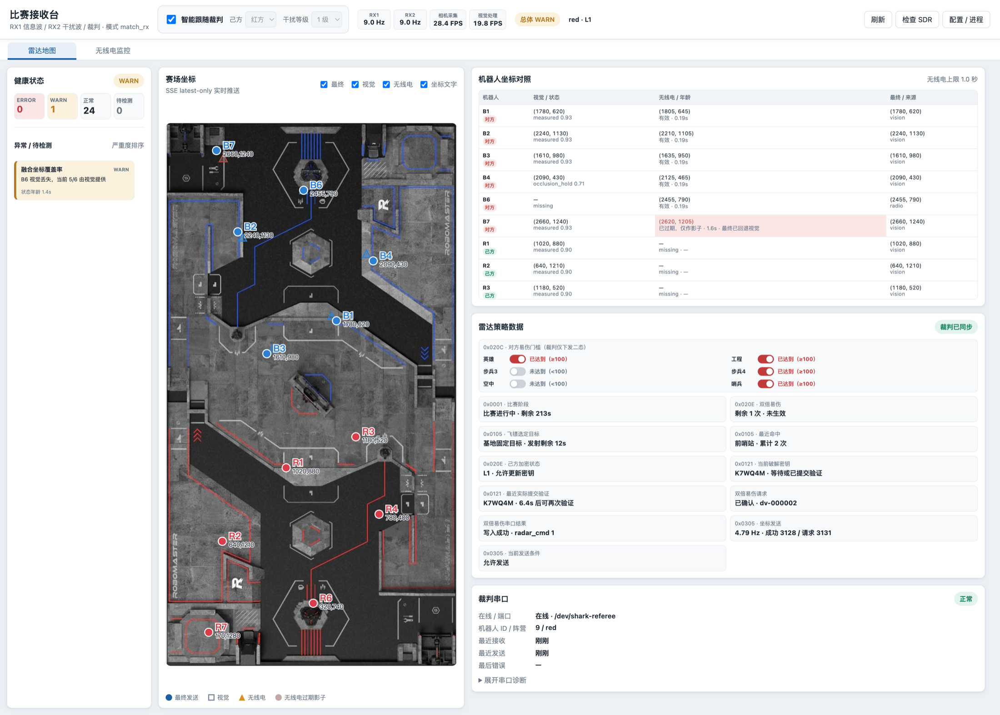
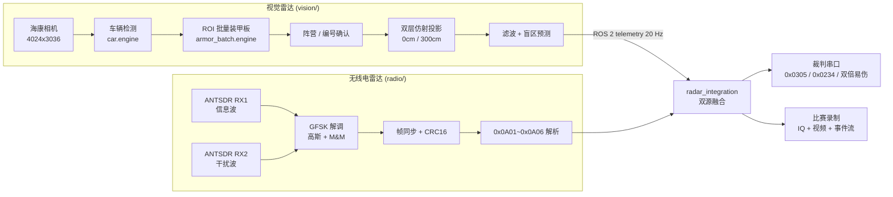
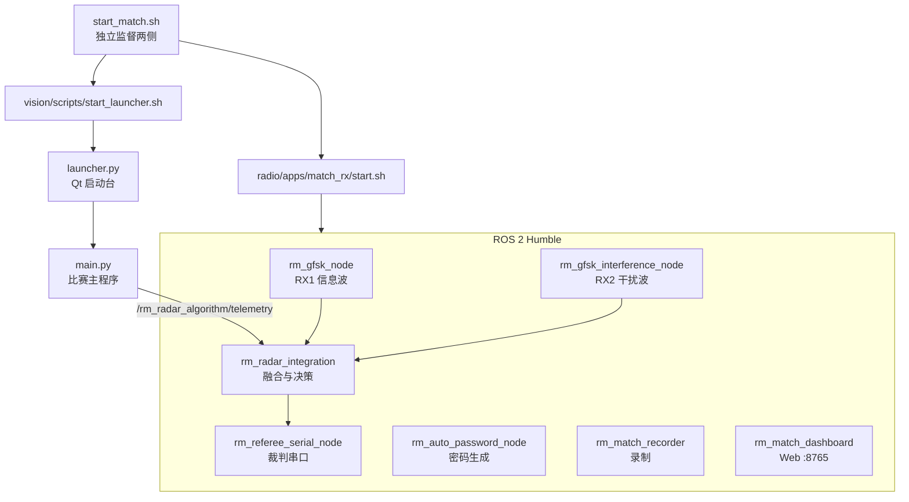

# SHARK Radar System

江南大学霞客湾校区 SHARK 战队 RoboMaster 2026 赛季雷达系统。视觉雷达与无线电雷达双源并行，融合后统一向裁判系统发送标记与决策。

本仓库是聚合仓库，两个子系统以 Git 子模块形式引入：

| 子模块 | 仓库 | 职责 |
| --- | --- | --- |
| `vision/` | [shark-radar-vision](https://github.com/JNU-SHARK/shark-radar-vision) | 相机取图、车辆与装甲板识别、双层仿射投影到赛场地图 |
| `radio/` | [shark-radar-radio](https://github.com/JNU-SHARK/shark-radar-radio) | SDR 接收空中广播、解调 0x0A01~0x0A06、双源融合、裁判串口收发 |

## 本项目亮点

- **双源融合定位**：无线电给出全场无遮挡但低速率的敌方位置，作为敌方坐标的主来源；视觉受遮挡限制，但能提供己方目标，并在无线电不可用时作为回退。两者在无线电侧按时效性分级融合，任一源失效仍可继续标记。
- **完整的无线电雷达链路**：从 GFSK 解调、帧同步、CRC 校验到六条空中命令解析全部自建，附带实验室发射台用于无硬件外场条件下的闭环调试。
- **赛后可完整复现**：比赛过程同时归档相机与地图视频、原始 IQ 采样、ROS 话题事件流，统一 `match_run_id` 归档，可离线重放 IQ 复现任意一帧的解调结果。
- **自研 Web Dashboard，现场排查一目了然**：实时频谱与双路瀑布图、赛场地图三源叠加点位、机器人坐标对照、按阶段拆开的逐帧解析诊断、健康状态与进程管理，集成在一个浏览器页面。比赛时看这一页就能判断链路好坏与故障环节，不用翻日志。视觉侧另有 Qt 启动台负责相机、标定、录像与一键启动。
- **单侧掉线独立重启**：一键启动脚本独立监督视觉与无线电，任一侧异常退出只重启故障侧，另一侧不受影响。



比赛时的主视图：左侧健康状态与异常列表，中间赛场地图三源叠加点位，右侧机器人坐标对照（逐台列出视觉 / 无线电 / 最终坐标与来源）、裁判策略数据与串口状态。图中 B6 是视觉丢失后由无线电接管的例子，B7 是无线电已过期、回退视觉的过期影子。更多界面见 [`radio/README.md` 第 8 节](radio/README.md#8-功能详解比赛接收台-dashboard8765)。

> 截图仅为界面效果展示，内容由模拟数据驱动，不是真实比赛记录 — 面板结构与协议字段与代码一致，但具体数值都是构造的。

## 1 功能介绍

雷达的任务是在比赛中持续定位对方机器人，向裁判系统发送标记进度，并在合适时机申请双倍易伤。本系统把这件事拆成两条互补的感知链路和一层融合决策：

**视觉链路**（`vision/`）用一台海康工业相机俯视全场，YOLOv5 检测车辆框，对每辆车的 ROI 批量识别装甲板得到编号与阵营，再通过 0 cm / 300 cm 两层仿射变换把像素落点投影为 2800×1500 的赛场坐标。配合阵营保持、遮挡保持、盲区预测与门控卡尔曼滤波，输出稳定的目标轨迹。

**无线电链路**（`radio/`）用两台 ANTSDR 接收对方基地广播的信息波与干扰波。信息波承载 0x0A01~0x0A05（敌方位置、血量、发弹量、宏观状态、增益状态），干扰波承载 0x0A06 六位干扰密钥。GNU Radio flowgraph 完成 FM 鉴频、高斯滤波与 M&M 定时恢复，解调后经帧同步与 CRC16 校验解出各条命令。

**融合与决策**（`radio/` 的 `radar_integration` 节点）合并两条链路的位置观测。两条链路分工不对等：敌方坐标以无线电为主来源（全场无遮挡），视觉在无线电断流时作为回退；己方坐标只能来自视觉，因为无线电只播对方信息。融合按视觉状态与无线电数据年龄决定每个目标的最终来源，然后发送裁判 0x0305 标记、团队自定义 0x0234 无敌目标广播，并按 ROI 停留与血量骤降条件自动申请双倍易伤。

## 2 系统架构

### 2.1 数据流



### 2.2 进程与节点边界



视觉主程序不直接开串口。比赛默认 `referee.transport: radio_ros`，视觉把目标遥测发到同机 ROS 2，由无线电侧统一限速后写入裁判串口，避免两个进程争抢同一个串口设备。

## 3 硬件环境

| 项目 | 型号 / 参数 |
| --- | --- |
| 操作系统 | Ubuntu 22.04 LTS |
| ROS | ROS 2 Humble |
| 相机 | 海康工业相机（USB3，4024×3036） |
| 信息波接收 | ANTSDR E310 + 六单元八木天线（垂直极化，正对官方发射源），`ip:192.168.9.110` |
| 干扰波接收 | ANTSDR E310 + 玻璃钢全向天线，`ip:192.168.9.111` |
| 信息波发射（实验室） | ADALM-Pluto，`ip:192.168.2.1` |
| 干扰波发射（实验室） | ADALM-Pluto，`ip:192.168.3.1` |
| 裁判系统 | USB 转串口，`/dev/shark-referee`，115200 |
| 数据盘 | 外接 2 TB，挂载于 `/media/shark/Resources` |

比赛机只需要两台 RX；两台 TX 仅在实验室调试链路时使用。表中 IP 与设备路径是本队部署值，换机器需按自己的硬件改 `radio/apps/*/config.yaml` 与 udev 规则。

**SDR 不限于 ANTSDR** — 凡是 AD9361 板子（普通 ADALM-Pluto 及各类 Pluto 兼容板）都兼容，只需改 URI。但**至少要用带网口的板子**：纯 USB 2.0 供电 + 传输在长时间连续取流下普遍不稳定，多所学校反馈过烧板。详见 [`radio/README.md` 第 3 节](radio/README.md#3-射频硬件)。

## 4 安装部署

### 4.1 克隆

```bash
git clone --recursive https://github.com/JNU-SHARK/shark-radar-system.git
cd shark-radar-system
```

已经克隆过但没带 `--recursive`：

```bash
git submodule update --init --recursive
```

### 4.2 安装两个子系统

两个子系统的依赖差异很大（一边是 CUDA/TensorRT，一边是 ROS 2/GNU Radio），分别按各自 README 安装：

- 无线电：[`radio/README.md`](radio/README.md) — ROS 2 Humble、GNU Radio 3.10.7、gr-iio、colcon 构建
- 视觉：[`vision/README.md`](vision/README.md) — CUDA 12.8、TensorRT 10.13、海康 MVS SDK、模型引擎转换

### 4.3 设备与存储

裁判串口固定命名（避免 `/dev/ttyUSB*` 序号漂移）：

```bash
# 查到串口芯片的 idVendor / idProduct
udevadm info -a -n /dev/ttyUSB0 | grep -E 'idVendor|idProduct' | head -4

sudo tee /etc/udev/rules.d/99-shark-referee.rules <<'EOF'
SUBSYSTEM=="tty", ATTRS{idVendor}=="1a86", ATTRS{idProduct}=="7523", SYMLINK+="shark-referee"
EOF
sudo udevadm control --reload-rules && sudo udevadm trigger
```

相机权限规则由视觉仓库提供：

```bash
sudo cp vision/scripts/99-hikrobot-usb.rules /etc/udev/rules.d/
sudo udevadm control --reload-rules && sudo udevadm trigger
```

外接数据盘挂载到 `/media/shark/Resources` 并确保可写。录制模块会在盘不可写或剩余空间不足时自动回落到本地目录，但比赛前应确认外接盘已就位。

### 4.4 开机自启（可选）

```bash
cd vision && ./scripts/install_autostart.sh    # 卸载用 uninstall_autostart.sh
```

## 5 启动

### 5.1 一键比赛

```bash
./start_match.sh
```

同时启动无线电比赛链路（双路 RX、裁判串口、融合节点、录制、Web Dashboard）和视觉比赛启动台。参数原样传给无线电启动器：

| 参数 | 作用 |
| --- | --- |
| `--no-browser` | 不自动打开 RX Dashboard |
| `--headless` / `--no-native-gui` | 不打开 GNU Radio 原生窗口 |
| `--native-gui` | 打开 GNU Radio 原生诊断窗口 |
| `--dry-run` | 不碰真实硬件，走空跑链路 |
| `--rx-only` | 只起接收，不开裁判串口与面板 |
| `--help` | 查看完整参数 |

监督行为：任一侧退出时打印告警，等 `MATCH_RESTART_DELAY_SEC`（默认 2 秒）后只重启故障侧，另一侧继续运行。`Ctrl+C` 同时停止两侧。

### 5.2 归档标识

启动脚本生成一个 `SHARK_MATCH_RUN_ID`（形如 `match_20260809_143052_12345`），无线电录制、融合日志与视觉录像共用这一个 ID 归档。单侧重启时该 ID 有意保持不变，这样一侧重启不会让另一侧的场次计数错位。需要指定时可自己传入：

```bash
SHARK_MATCH_RUN_ID=match_test_01 ./start_match.sh
```

### 5.3 实验室发射台

```bash
./start_tx.sh                       # 默认 http://127.0.0.1:8780
./start_tx.sh --no-browser
```

启动受保护的 LabTX 控制台。脚本本身不会发射 RF，真实发射需要在面板中勾选射频安全确认并手动开启。仅在合规竞赛场地或实验室屏蔽环境使用。

## 6 比赛日流程

1. **通电自检** — `cd radio && ./apps/match_rx/doctor.sh`，确认 `ros2` / `python3` / GNU Radio 运行时、两台 RX 的 iio 可达、裁判串口存在、录制目录与剩余空间。
2. **启动** — `./start_match.sh`。浏览器打开比赛接收台，Qt 启动台弹出。
3. **确认阵营与干扰等级** — 在 Dashboard 顶栏切换，运行中可热切换。
4. **相机标定** — 在 Qt 启动台确认相机序列号与录像目录，点「开始标定」，按每层 6 点标完 0 cm 与 300 cm 两层，保存后自动进入比赛主程序。
5. **赛中监控** — 「雷达地图」页看融合结果与健康状态，「无线电监控」页看频谱、瀑布图与解析诊断。
6. **赛后取数** — 录制在裁判 `game_progress=5` 后自动收尾。视频在 `/media/shark/Resources/SHARK-radar-recordings/<match_run_id>/`，IQ 与事件流在 `/media/shark/Resources/SHARK-radio-iq/` 与 `~/.local/share/shark-radio/match-records/`。

## 7 文件结构

```
shark-radar-system/
├── start_match.sh          # 一键比赛：独立监督视觉与无线电
├── start_tx.sh             # 一键实验室发射台（不自动发射 RF）
├── radio/                  # 子模块：无线电雷达
│   ├── apps/match_rx/      # 比赛接收应用（开裁判串口）
│   ├── apps/lab_tx/        # 实验室发射应用（永不开串口）
│   └── src/rm_radio_ros/   # ROS 2 包：节点、flowgraph、协议解析
├── vision/                 # 子模块：视觉雷达
│   ├── launcher.py         # Qt 比赛启动台
│   ├── main.py             # 比赛主程序
│   ├── calibration.py      # 手动标定
│   ├── tracking/           # 车辆轨迹链路
│   └── models/             # TensorRT 引擎与 ONNX/PT 权重
├── docs/                   # 开源文档
│   └── tech-report/        # 无线电雷达技术报告 PDF
└── *.pdf                   # RM2026 规则手册与通信协议
```

## 8 子模块维护

子模块指向固定 commit。子系统更新后需要在本仓库提交新的指针：

```bash
git submodule update --remote radio      # 拉取子模块最新提交
git add radio && git commit -m "chore: bump radio"
```

反过来，切换本仓库分支后子模块可能落后于记录版本：

```bash
git submodule update --init --recursive
```

## 9 开源文档

无线电雷达的空中协议、解调实现、射频前端设计、双源融合与比赛决策逻辑，完整技术报告见：

- [**SHARK RM2026 无线电雷达技术报告（PDF）**](docs/tech-report/SHARK-RM2026-Radio-Radar-Report.pdf)

报告涵盖六条空中命令的帧结构与解析、GFSK 解调链路的分级设计、射频前端选型与增益策略、
硬件要求、性能评估与测试方法，以及已知不足与后续方向。

## 10 参考资料

RM 雷达是一个各队互相参考着往前走的方向，这套系统从下面这些开源与分享里获益很多。

**无线电雷达**

| 来源 | 说明 |
| --- | --- |
| [【RM2026 雷达无线电开源】华南师范大学 PIONEER 战队](https://bbs.robomaster.com/article/1882741) | 无线电雷达整体方案开源 |
| [【BNBU Navigator 2026 雷达射频二阶段开源】+ 开发计划](https://bbs.robomaster.com/article/1884147) | 北师港浸大 Navigator 射频部分二阶段开源与开发计划 |
| [Navigator RMUC 2026 雷达射频开发小记](https://bbs.robomaster.com/article/1885744) | 同队的射频开发记录，硬件与调试踩坑 |

**视觉雷达**

| 来源 | 说明 |
| --- | --- |
| [RM2025 香港科技大学 ENTERPRIZE 战队单目雷达站算法开源](https://bbs.robomaster.com/article/761138) | 单目雷达站算法，附完整赛季易伤时间数据 |
| [RM2026 厦理PFA 雷达站算法开源](https://bbs.robomaster.com/article/1884254) | 厦门理工学院 PFA 单目相机雷达站算法 |

## 致谢

无线电雷达是这个赛季从零摸索的部分，研发过程中得到了很多队外的帮助。感谢**华东理工大学**、**应急管理大学**、**南京邮电大学**、**北师港浸大**等学校，以及 **RM 雷达群**的各位群友 — 在频点、天线架设、解调参数和踩坑经验上的交流，帮我们省掉了大量试错时间。

## 许可

MIT License。两个子系统同样采用 MIT。

视觉部分基于 [YOLOv5](https://github.com/ultralytics/yolov5) 二次开发，感谢上游工作。
