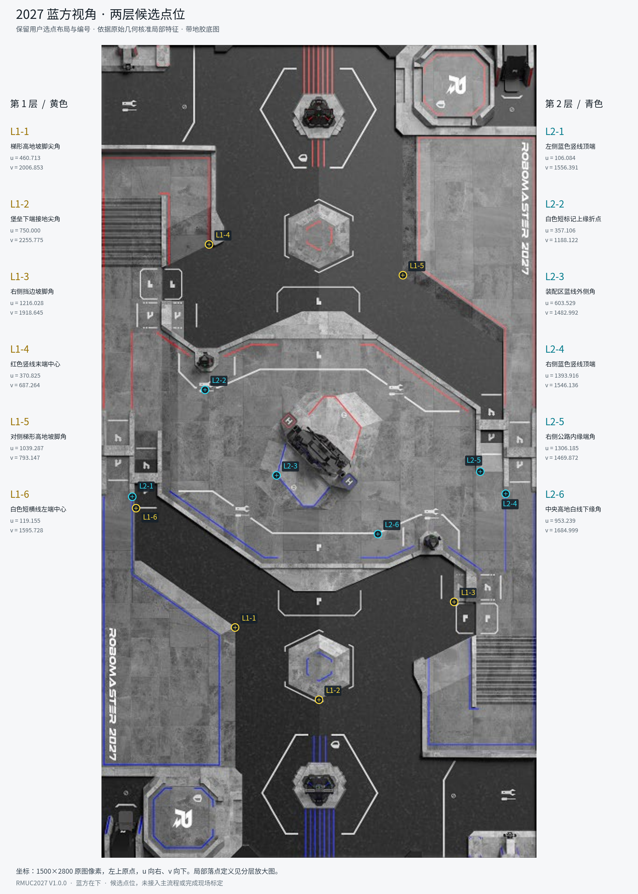
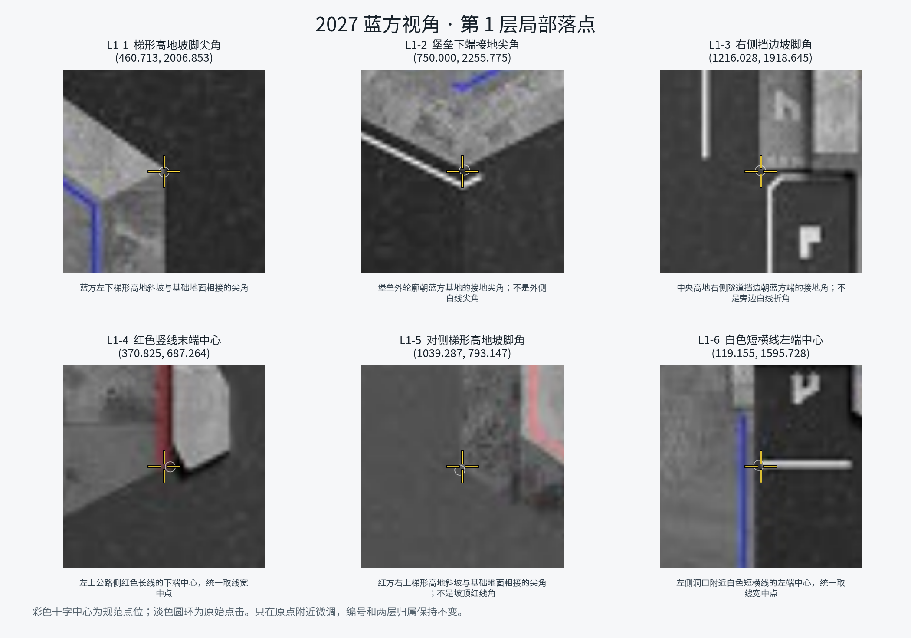
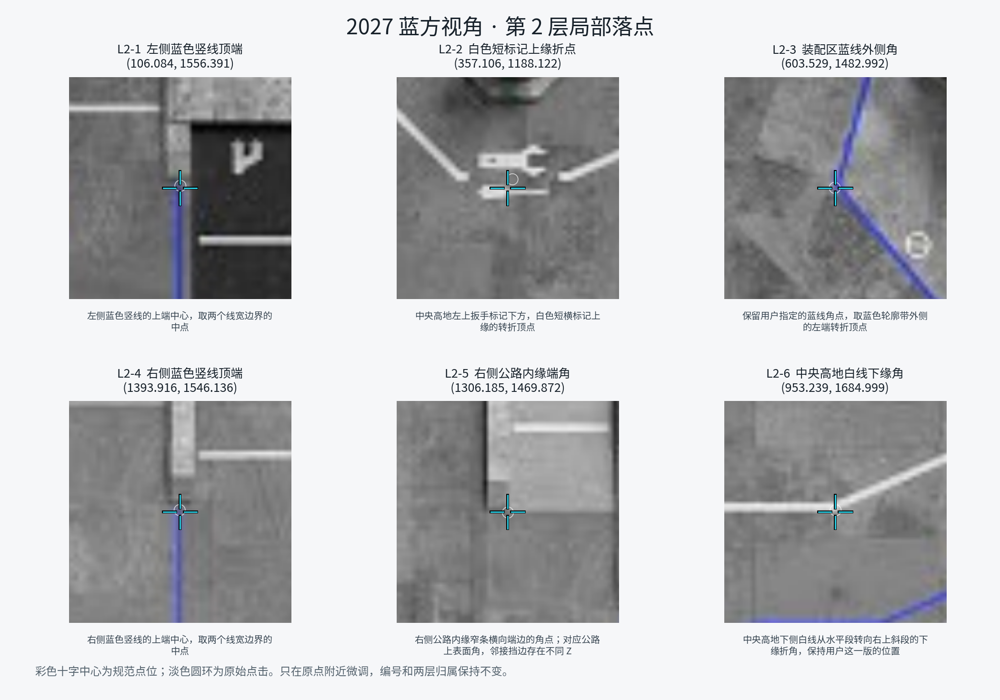

# 2027 赛季标定点说明与点位示意

更新：2026-11-13。蓝方点位版本：`rmuc2027-v1.0.0-user-blue-points1`。本页记录用户确认保留的蓝方候选点：第一层六点、第二层六点；现已补充 [红方对应候选集与示意图](map2027_red_calibration_points.md)。两侧点位和图片已归档，尚未接入正式标定预设、求解新矩阵或切换比赛配置。

## 1. 文件与坐标约定

| 内容 | 文件 |
|---|---|
| 规范后的点位与几何依据 | [points_B.json](map2027-selected-points-v1/points_B.json) |
| 用户最后一版原始点选记录 | [source_selection_B.json](map2027-selected-points-v1/source_selection_B.json) |
| 总体点位示意 | [overview_B.png](map2027-selected-points-v1/overview_B.png) / [SVG](map2027-selected-points-v1/overview_B.svg) |
| 第一层局部示意 | [layer1_details_B.png](map2027-selected-points-v1/layer1_details_B.png) |
| 第二层局部示意 | [layer2_details_B.png](map2027-selected-points-v1/layer2_details_B.png) |
| 坐标规范过程与验证记录 | [资产说明](map2027-selected-points-v1/README.md) |

图片和数据集中放在本目录下的 `map2027-selected-points-v1/`，本文直接嵌入，不依赖用户主目录或临时截图。所有示意以**带地胶的 2027 底图**为视觉依据；CAD 原始几何数据仅用于核对局部特征坐标，不使用无地胶的黑色 CAD 渲染图判断落点。

- 地图：`vision/images-2027/display-v1.0.0/blue_bottom.png`，蓝方在下，1500×2800 像素。
- `(u, v)` 为原图像素坐标，左上角原点，u 向右、v 向下；不受工具窗口缩放比例影响。
- `map_points[0]` 为第一层，`map_points[1]` 为第二层；各数组从第一个点开始对应编号 1～6。
- 蓝方竖图到当前参考场地坐标的关系为 `X_cm=v`、`Y_cm=u`；参考坐标的实地原点、方向、尺度仍需核验。
- 黄色、青色分别标识第一、第二层，是本说明图的配色。正式标定窗口可能使用不同颜色，应以层号和点序匹配。
- 第一层、第二层是现有算法的两组点，**不是固定的 0 cm／300 cm 高度**。点位分组不代表已经证明每组物理共面。

## 2. 总体点位示意

## 3. 第一层：基础地面及接地特征

| 编号 | u | v | 明确的落点定义 |
|---|---:|---:|---|
| L1-1 | 460.713 | 2006.853 | 蓝方左下梯形高地斜坡与基础地面相接的尖角。 |
| L1-2 | 750.000 | 2255.775 | 堡垒外轮廓朝蓝方基地的接地尖角；与外侧白线尖角区分。 |
| L1-3 | 1216.028 | 1918.645 | 中央高地右侧隧道挡边朝蓝方端的接地角；与旁边白线折角区分。 |
| L1-4 | 370.825 | 687.264 | 左上公路侧红色长线的下端中心，取线宽中点。 |
| L1-5 | 1039.287 | 793.147 | 红方右上梯形高地斜坡与基础地面相接的尖角，注意坡脚与坡顶红线的区别。 |
| L1-6 | 119.155 | 1595.728 | 左侧洞口附近白色短横线的左端中心，取线宽中点。 |

L1-1、L1-3、L1-5 需在相机中确认看到的是接地边。L1-4、L1-5 位于较远端，图上距蓝方底边约 20～21 m；这不是已测得的相机视距，能否分辨对应细节应以实际安装画面为准。

## 4. 第二层：保留用户选定的高区特征

| 编号 | u | v | 明确的落点定义 |
|---|---:|---:|---|
| L2-1 | 106.084 | 1556.391 | 左侧蓝色竖线的上端中心，取线宽中点。 |
| L2-2 | 357.106 | 1188.122 | 中央高地左上扳手标记下方，白色短横标记上缘的转折顶点。 |
| L2-3 | 603.529 | 1482.992 | 用户指定的装配区蓝线角点，取蓝色轮廓带外侧的左端转折顶点。 |
| L2-4 | 1393.916 | 1546.136 | 右侧蓝色竖线的上端中心，取线宽中点。 |
| L2-5 | 1306.185 | 1469.872 | 右侧公路内缘窄条横向端边的上表面角点。 |
| L2-6 | 953.239 | 1684.999 | 中央高地下侧白线由水平段转向右上斜段的下缘折角。 |

局部图的彩色十字中心为规范落点，淡色圆环为原点击。12 点保持原布局与顺序，最大微调为 L2-2 的 7.222 个地图像素。

L2-3 按用户确认保留，原始几何中归属中央装配区结构；其 Z 不按中央高地地面统一填写。L2-5 邻接的挡边存在几乎相同 XY、不同 Z 的几何，现场需确认看到的是公路上表面角点。当前第二层仍包含不同表面，后续继续沿用两张单应矩阵时应独立检验各区域误差，本次不改变投影算法。

## 5. 后续正式标定时如何对应

1. 先固定相机安装、镜头、对焦、ROI 和分辨率；按精度要求完成本机内参及去畸变核验。标定、比赛使用同一像素坐标域。
2. 现已由 `vision/map_runtime.yaml` 默认启用共享 2027 档案，蓝方自动选择蓝方底图、蓝方 mask27、对应点位和独立新矩阵路径；具体操作见 [运行档案接入说明](map2027_runtime_integration.md)。
3. 两组 `map_points` 已转入独立的 `vision/calibration_presets_2027.json` 并带资产绑定；标定窗口自动导入当前侧六点／层方案，在相机图像中点选对应实体特征。独立选点 JSON 仍不能直接替代预设库。
4. 相机点严格按每层 1～6 与地图点一一对应。文档 L1-1 对应代码 `map_points[0][0]`，L2-6 对应 `[1][5]`；正式窗口若从 0 编号，需注意索引差异。
5. 每层需要六个**相机点＋地图点**对应。当前已有十二个地图点，尚缺十二个相机图像点；不能仅靠地图点生成真实标定矩阵。
6. 保存后使用未参与拟合的已知点和实车位置检查近远端、左右、高地及坡口误差，再决定是否满足使用要求。拟合点残差不能替代独立验收。

现已有 [红方候选集](map2027_red_calibration_points.md)，按红方对应实体逐点核对，图案不同的 L2-2 单独选角。红方仍需在实际安装画面中确认可见性、采集图像点并重新标定；没有把候选数据标成已验收红方点。

## 6. 当前状态

点位数据、总图和两张局部图已准备，正式预设与运行档案已接通；版本、来源与局部几何依据可追溯。真实内参、相机对应点、2027 矩阵和独立误差记录仍未完成。

整个接入链路的素材及代码缺口见 [2027 接入准备度检查](map2027_integration_readiness.md)。地图与外参标定父级 TODO 保持未完成。
