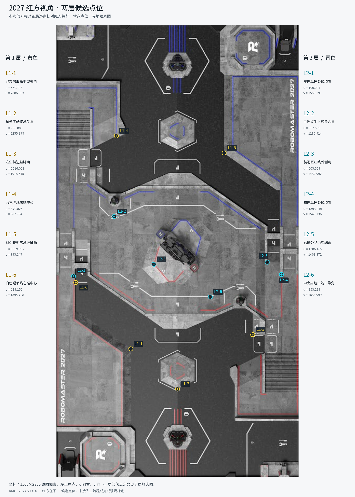
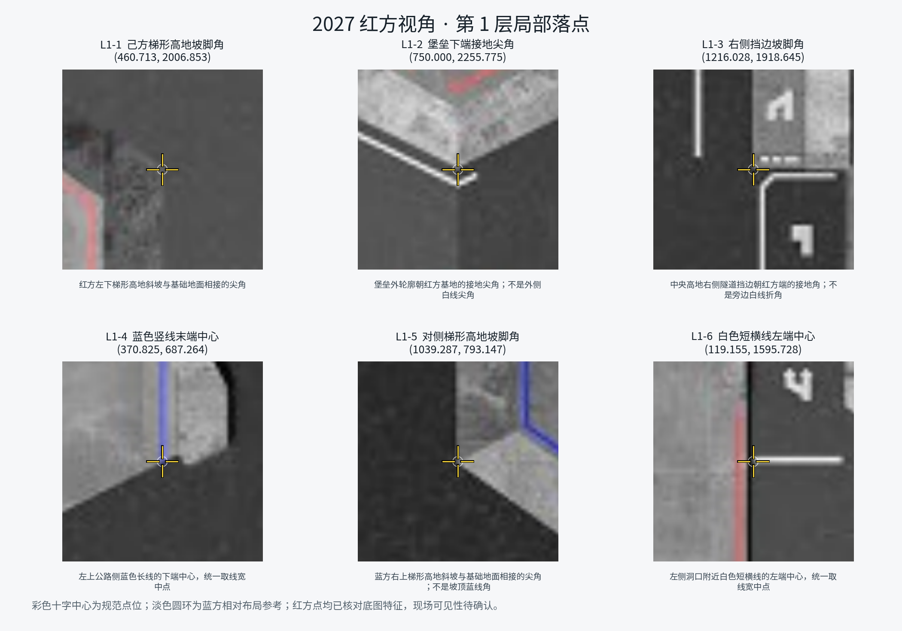
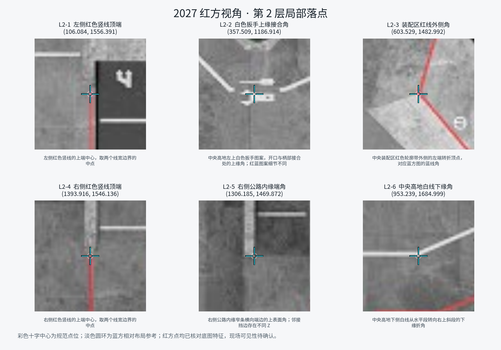

# 2027 红方两层候选标定点

日期：2026-11-13。版本：`rmuc2027-v1.0.0-red-candidates1`。参考用户确认的蓝方布局，逐点核对红方对应的实体特征，保持两层各六点及 L1-1～L2-6 的编号。当前是红方地图候选集，尚无红方相机图像点、矩阵或现场可见性验收。

## 文件与坐标

- [红方坐标与原始几何依据](map2027-selected-points-v1/points_R.json)。
- [红方总图 PNG](map2027-selected-points-v1/overview_R.png) / [SVG](map2027-selected-points-v1/overview_R.svg)。
- [第一层局部图](map2027-selected-points-v1/layer1_details_R.png)、[第二层局部图](map2027-selected-points-v1/layer2_details_R.png)。
- [蓝方点位说明](map2027_calibration_points.md)。

底图为 `vision/images-2027/display-v1.0.0/red_bottom.png`，红方在下，1500×2800 像素。u 向右、v 向下，左上原点；参考场地坐标为 `X_cm=2800-v`、`Y_cm=1500-u`。黄色表示第一层，青色表示第二层，与被选标线本身的颜色无关。

每个点均在带地胶的红方图上确认特征，并用原始 CAD 网格对应部件的顶点／线端中点核对数值，没有使用黑色 CAD 渲染图。几何来源、部件、实际 CAD XYZ 和蓝方参考文件哈希保存在 JSON 中；网格化偏差参数仍为原资产的 5 mm，不以坐标小数作为实地精度承诺。

## 红蓝点位为何数值接近

红方候选选的是**红方安装侧相同相对位置的对应实体**。场地大部分特征中心对称，所以各自“己方在下”的竖图坐标可以接近或相同，但实际 CAD 点和阵营不同。

这与“把蓝方同一组实体旋转到红方图上显示”不同；后者会得到 `(1500-u, 2800-v)` 并把蓝方近端实体转到红方远端。本次逐点选取了对侧对应实体，不能仅改 `side` 字段当作红方数据。

标线颜色也需相应变化：蓝方 L1-4 的红线对应红方图中的蓝线；蓝方 L2-1、L2-3、L2-4 的蓝线对应红方图中的红线。**L2-2 的白色图案细节不完全对称，已改取红侧扳手图案的上缘接合角**，坐标与蓝方不同。

## 总图

## 第一层

| 编号 | u | v | 明确的落点定义 |
|---|---:|---:|---|
| L1-1 | 460.713 | 2006.853 | 红方左下梯形高地斜坡与基础地面相接的尖角。 |
| L1-2 | 750.000 | 2255.775 | 堡垒外轮廓朝红方基地的接地尖角；不是外侧白线尖角。 |
| L1-3 | 1216.028 | 1918.645 | 中央高地右侧隧道挡边朝红方端的接地角；不是旁边白线折角。 |
| L1-4 | 370.825 | 687.264 | 左上公路侧蓝色长线的下端中心，统一取线宽中点。 |
| L1-5 | 1039.287 | 793.147 | 蓝方右上梯形高地斜坡与基础地面相接的尖角；不是坡顶蓝线角。 |
| L1-6 | 119.155 | 1595.728 | 左侧洞口附近白色短横线的左端中心，统一取线宽中点。 |

## 第二层

| 编号 | u | v | 明确的落点定义 |
|---|---:|---:|---|
| L2-1 | 106.084 | 1556.391 | 左侧红色竖线的上端中心，取两个线宽边界的中点。 |
| L2-2 | 357.509 | 1186.914 | 中央高地左上白色扳手图案，开口与柄部接合处的上缘角；红蓝图案细节不同。 |
| L2-3 | 603.529 | 1482.992 | 中央装配区红色轮廓带外侧的左端转折顶点，对应蓝方图的蓝线角。 |
| L2-4 | 1393.916 | 1546.136 | 右侧红色竖线的上端中心，取两个线宽边界的中点。 |
| L2-5 | 1306.185 | 1469.872 | 右侧公路内缘窄条横向端边的上表面角；邻接挡边存在不同 Z。 |
| L2-6 | 953.239 | 1684.999 | 中央高地下侧白线从水平段转向右上斜段的下缘折角。 |

十字中心为候选落点；淡色圆环是用于寻找对应特征的蓝方相对布局参考，不是用户在红方图上的原始点击。JSON 中的 `reference_seed_map_uv` 及 `shift_map_px` 也仅描述相对该参考位置的微调。

## 使用与验证边界

- 红方应配 `red_bottom.png`、`map_mask27_red.png`，以及将来按真实红方相机画面重新求解的矩阵；不沿用蓝方矩阵。
- 点位数组顺序与文档编号一一对应。相机点必须选择同一实体特征：例如 L1-2 接地尖角与其外侧白线尖角是不同落点。
- L2-3 仍是装配区结构上的轮廓角，L2-5 邻接不同高度的挡边。本次沿用用户既定的两层策略，未声称这些表面共面或已达到定位精度。
- 远端点、贴边点能否从正式安装视角辨认，必须在训练／搭建后的场地确认。需要调整时同时更新相机点、地图点和说明，不能只移动一端。
- 已核对红方底图哈希、12 个点的范围／顺序／原始几何依据，以及 CAD→场地→红方像素的往返关系；已检查总图与两张局部图。尚未实拍、求解矩阵或接入主流程。

正式预设、资产绑定、相机采样时机、Dashboard 和盲区预测的后续处理见 [接入准备度与实施建议](map2027_integration_readiness.md)。现场标定父级 TODO 继续未完成。
