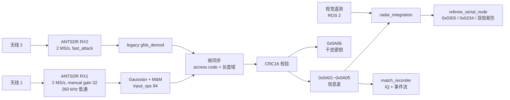
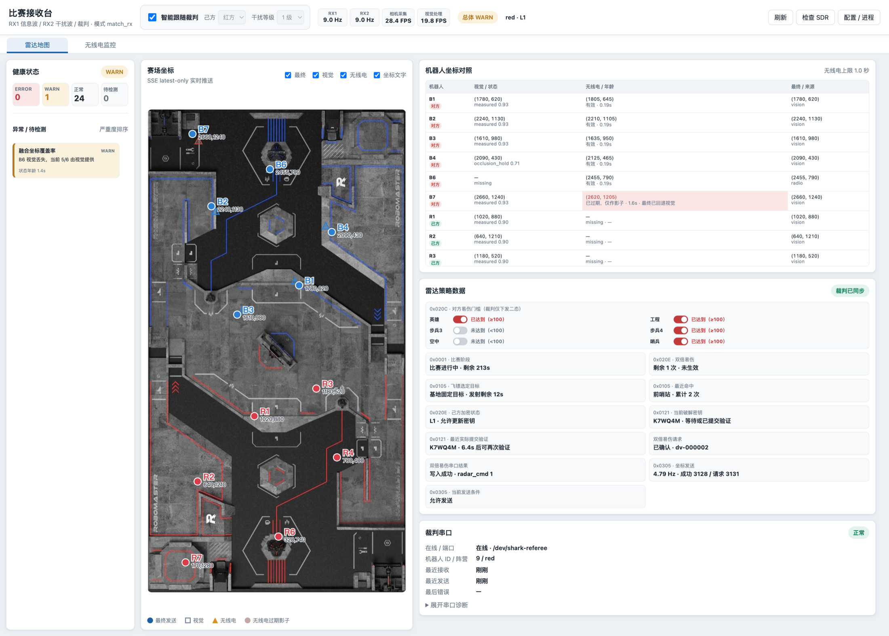
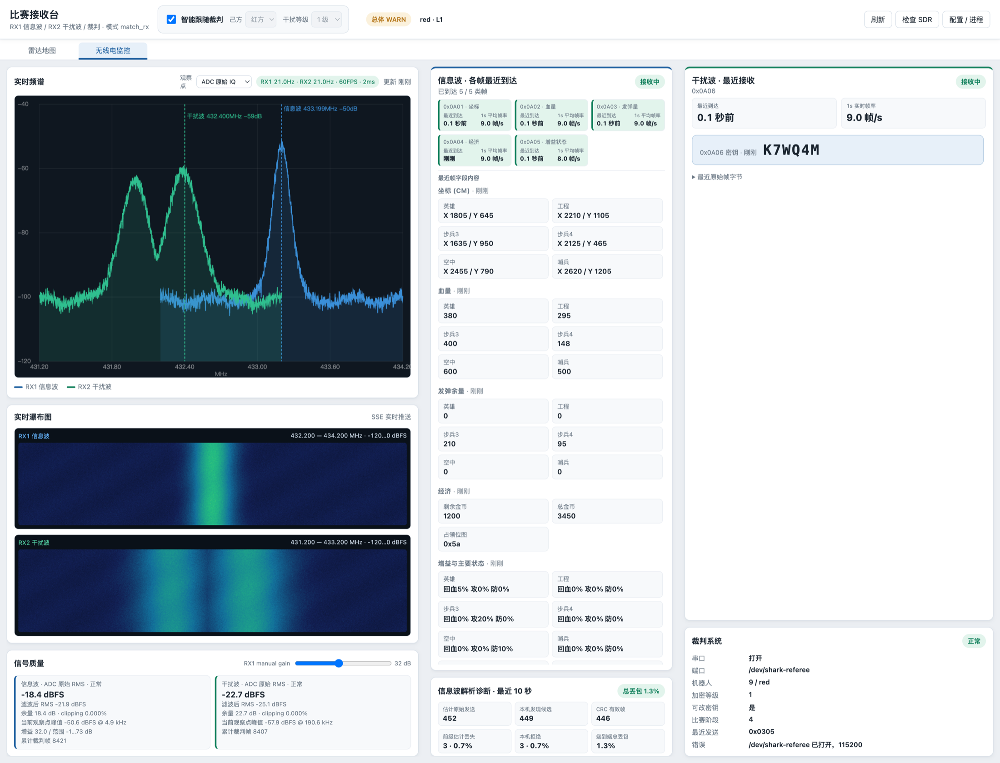
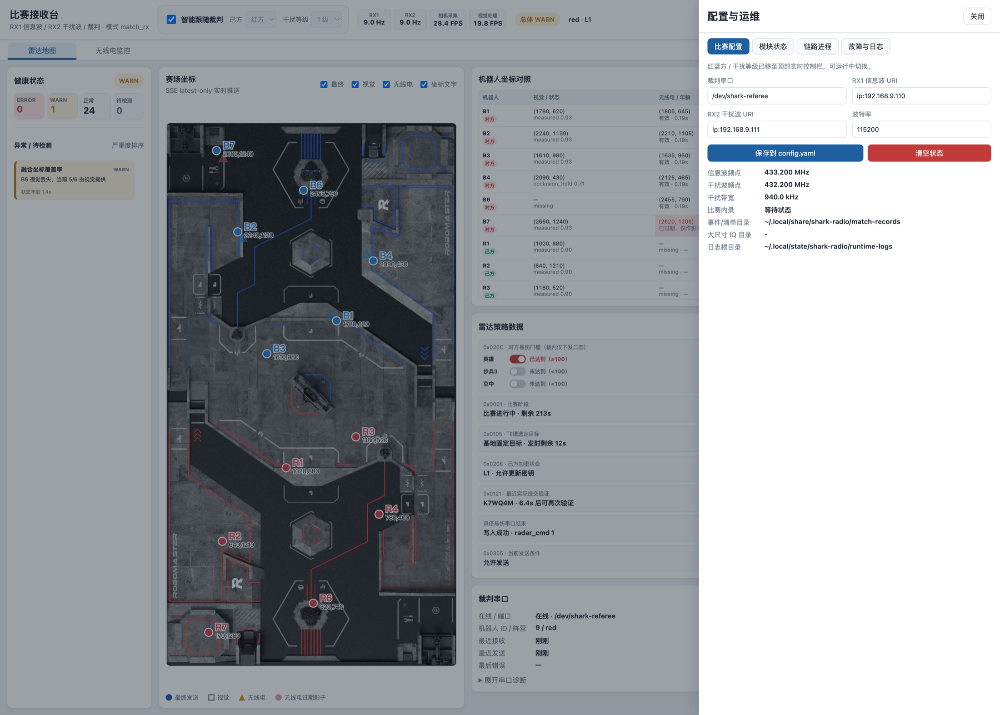
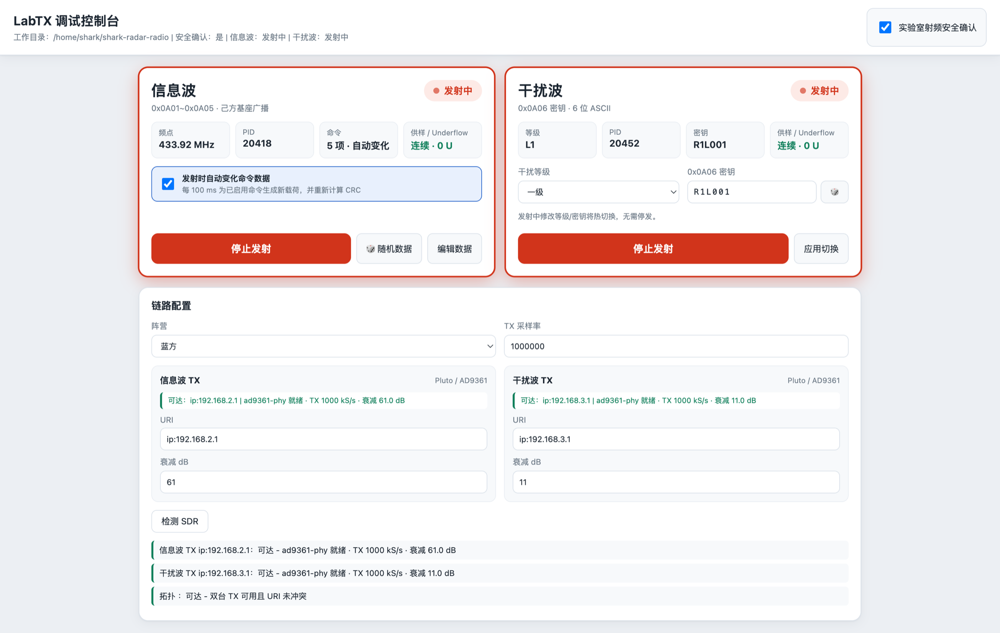

# SHARK Radar Radio

江南大学霞客湾校区 SHARK 战队 RoboMaster 2026 赛季**无线电雷达**。用 ROS 2 Humble 包装 GNU Radio flowgraph，接收对方基地的空中广播，解调出敌方全场信息，与视觉雷达融合后统一发送裁判系统指令。

本仓库是 [shark-radar-system](https://github.com/JNU-SHARK/shark-radar-system) 的 `radio/` 子模块，也可独立使用。

## 本项目亮点

- **完整自建的空中链路**：从 gr-iio 取样、FM 鉴频、高斯滤波、M&M 定时恢复，到帧同步、CRC16 校验与六条 0x0A0x 命令解析，全链路开源可改。
- **双解调路径并存**：信息波走连续流 Gaussian + M&M，干扰波走 legacy 流式解调，IQ 快照解码器作为可随时启用的诊断回退。
- **自动调谐带粘滞锁定**：在 (频偏, 低通, SPS) 网格上搜索最优解调参数，命中后锁定并只做快速扫描，连续失败才回退全扫。
- **干扰波时间分集表决**：对重复的密码帧逐位多数表决，单帧过不了 CRC 时仍能解出 0x0A06。
- **实验室发射台**：独立的 LabTX 应用可发射合法信息波与干扰波，无外场条件也能闭环调试接收链路。
- **比赛全过程可复现**：自动录制原始 IQ、ROS 话题事件流与配置快照，赛后可离线重放任意时刻的解调过程。
- **自研 Web Dashboard（本项目最直观的部分）**：实时频谱、双路瀑布图、赛场地图叠加点位、机器人坐标三源对照、逐帧解析诊断、健康状态与进程管理，全部集成在一个浏览器页面里。比赛时看这一个页面就能判断链路是好是坏、坏在哪一环，不用去翻日志或开 GNU Radio 原生窗口。

## 1 功能介绍

RoboMaster 2026 赛季雷达可以通过无线电接收对方基地广播的信息。广播分两路：

- **信息波** — 承载 `0x0A01`(敌方位置) `0x0A02`(血量) `0x0A03`(发弹量) `0x0A04`(宏观状态) `0x0A05`(增益状态)，是无遮挡的全场敌情来源。
- **干扰波** — 承载 `0x0A06`，六位 ASCII 干扰密钥。

本仓库负责接收并解调这两路广播，然后：

1. 把无线电位置与视觉位置融合，按时效性决定每个目标的最终坐标来源；
2. 向裁判系统发送 `0x0305` 标记进度；
3. 向本方机器人广播团队自定义的 `0x0234` 无敌目标消息；
4. 按 ROI 停留时长与敌方血量骤降自动申请双倍易伤；
5. 全程录制 IQ 与话题事件流。

## 2 系统架构

### 2.1 射频与数据流



### 2.2 ROS 节点

| 入口点 | 作用 |
| --- | --- |
| `rm_gfsk_node` | RX1 信息波接收与解调，发布帧与状态 |
| `rm_gfsk_interference_node` | RX2 干扰波接收与解调 |
| `rm_ganraoyuan_node` | 干扰源发射 flowgraph（实验室） |
| `rm_referee_serial_node` | 裁判串口收发，0x0305 / 0x0234 组帧 |
| `rm_radar_integration` | 视觉与无线电双源融合、双倍易伤决策 |
| `rm_auto_password_node` | 六位干扰密码生成与下发 |
| `rm_match_recorder` | 按裁判赛况自动录制 IQ 与话题事件 |
| `rm_match_dashboard` | Web 运维界面（HTTP + SSE） |
| `rm_iq_replay_tx_node` | 把录好的 IQ 回放到 TX |
| `rm_offline_iq_scan` | 离线 IQ 参数扫描与解码 |
| `rm_virtual_link_test` | 不接硬件的全链路自环测试 |
| `rm_find_usb_serial` | 串口设备探测 |

节点的话题命名统一为相对命名空间：`~/status`、`~/frames`、`~/referee_bridge`、`~/setters_json`、`~/spectrum`、`~/filtered_spectrum`，串口节点额外有 `~/rx_frames`、`~/tx_frames`、`~/raw_rx`、`~/game_status`。每个 flowgraph 节点提供 `~/start`、`~/stop`、`~/reload`、`~/status_trigger` 四个 `Trigger` 服务。

## 3 射频硬件

无线电雷达的成绩上限在硬件选型和天线架设上，软件只能在这个上限之下发挥。这一节是我们实测下来值得照抄的部分。

### 3.1 本队配置

| 用途 | SDR | 天线 |
| --- | --- | --- |
| 信息波接收（RX1） | ANTSDR E310 | **六单元八木天线**，垂直极化，正对官方发射源 |
| 干扰波接收（RX2） | ANTSDR E310 | 玻璃钢全向天线 |
| 信息波发射（实验室） | ADALM-Pluto | 实验室短天线 |
| 干扰波发射（实验室） | ADALM-Pluto | 实验室短天线 |

比赛机只需要两台 RX。两台 TX 仅在实验室复现发射链路时使用。

### 3.2 天线选型的理由

**信息波用定向八木**。官方发射源位置固定，信息波是这套系统最关键的数据来源（敌方位置、血量、发弹量全在这一路），值得用定向天线换增益和前后比。六单元八木的增益足够把链路余量拉开，同时它对来自其他方向的邻道干扰有天然抑制 — 这比在软件里加滤波便宜得多。

架设三个要点：

- **垂直极化** — 必须与官方发射源的极化方向一致。极化失配的损耗可以到十几 dB，比增益差距大得多，这是最容易被忽略又代价最高的错误。
- **正对发射源** — 八木的波束窄，指向偏了增益就白给。架好后建议用 Dashboard 的信号质量面板边转边看，找到解析成功率最高的方位再锁死。
- **远离己方干扰源** — 尽量避开自家电源、图传和其他 SDR。

**干扰波用玻璃钢全向**。干扰波只需要解出六位密码，数据量极小，对信噪比要求远低于信息波；但它的来源方向不像信息波那么确定，全向天线省掉了对准这一步。玻璃钢天线的好处是结构结实、耐户外、架设方便。

### 3.3 不一定要 ANTSDR

**芯片层面，凡是 AD9361 的板子都兼容**。本项目的 flowgraph 通过 gr-iio 与 libad9361 访问设备，不依赖 ANTSDR 特有的东西。普通 ADALM-Pluto 及各类 Pluto 兼容板（含各种第三方改版）都能直接用，只需要改 `config.yaml` 里的 URI。

**但至少要用带网口的板子。** 这一点务实一点讲：

- **纯 USB 2.0 的板子供电与传输都不够稳定。** USB 2.0 供电余量本来就紧，AD9361 加 FPGA 满载取流时电流会顶到上限；同一条线既供电又跑 2 MS/s 的连续 I/Q，遇到线材质量一般或主机 USB 控制器带宽紧张，就会出现丢样本、掉设备、`iio_readdev` 中断。
- **烧毁不是个例。** 不少学校反馈过纯 USB 供电的 Pluto 在长时间连续取流下损坏。我们不建议在比赛机上冒这个风险。
- **网口方案稳定得多。** 走以太网（或 USB 网络 + 独立供电）把供电和数据分开，长时间连续取流的稳定性完全是另一个量级。本项目的 URI 全部用 `ip:` 形式就是因为这个 — 而且 `ip:` 地址固定，不像 `usb:X.Y.Z` 会随总线枚举顺序变化，重插一次设备就得改配置。

选型建议：**带千兆网口 + 独立供电的 AD9361 板子**。ANTSDR E310 是我们用的型号，其他满足这个条件的板子同样可以。

### 3.4 关键射频参数

| 参数 | 值 | 说明 |
| --- | --- | --- |
| 接收采样率 | 2 MS/s | 空中波形 1 MS/s 的 2 倍过采样 |
| `input_sps` | 94 | 空中 SPS=47 对应 2 倍过采样 |
| RX RF 端口 | `B_BALANCED` | AD9361 的平衡输入 |
| 信息波增益模式 | `manual`，32 dB | 不用 AGC，见下 |
| 信息波增益上限 | 73 dB | 部署的 AD9361 报告 `hardwaregain_available=[-1 1 73]` |
| 信息波低通 | 260 kHz | 抑制邻道，同时留够 GFSK 主瓣 |
| 干扰波增益模式 | `fast_attack` | 突发的常量密码帧，快速起攻更容易抓到 |

**信息波为什么不能用 AGC**：邻道有干扰波存在时，AGC 会让增益持续抖动，解调的定时恢复和自动调谐参数跟着漂，表现为解析成功率忽高忽低。启动器强制要求 manual 模式，并通过 AD9361 readback 验证模式和增益值都真的写进去了 — 只发命令不回读，遇到设备状态异常时会静默失效。

### 3.5 频率规划

两路 RX 的中心频点随阵营切换，干扰波还随干扰等级切换。全部定义在 `core/radio_config.py`，Dashboard 的高级抽屉里会只读显示当前生效值。

| 用途 | 红方 | 蓝方 | 带宽 |
| --- | --- | --- | --- |
| 信息波（RX1） | 433.200 MHz | 433.920 MHz | 540 kHz 收发带宽 / 260 kHz 低通 |
| 干扰波 · 一级 | 432.200 MHz | 434.920 MHz | 940 kHz |
| 干扰波 · 二级 | 432.500 MHz | 434.620 MHz | 860 kHz |
| 干扰波 · 三级 | 432.800 MHz | 434.320 MHz | 250 kHz |

注意两路频点相距只有几百 kHz 到 1.7 MHz：干扰波对信息波是实打实的邻道干扰，这正是信息波要用定向天线 + 260 kHz 低通 + 固定增益的原因。红方的干扰波频点在信息波下方，蓝方在上方。

## 4 两个应用的区别

这是最容易误用的地方。仓库里有两个独立应用，配置、端口和安全策略都不共享：

| | `apps/match_rx` | `apps/lab_tx` |
| --- | --- | --- |
| 用途 | 比赛接收 | 实验室发射调试 |
| 端口 | `:8765` | `:8780` |
| 裁判串口 | 打开 | **永不打开** |
| 射频发射 | 无 | 有，需安全确认 |
| 配置文件 | `apps/match_rx/config.yaml` | `apps/lab_tx/config.yaml` |
| 启动 | `./apps/match_rx/start.sh` | `./apps/lab_tx/start.sh` |

比赛链路是纯接收的，不具备任何发射能力。发射只存在于 LabTX，且需要在面板上逐次勾选射频安全确认（对应 `RM_RADIO_LAB_TX_ANTENNA_CONFIRM`），配置文件里的 `lab_antenna_confirm` 始终提交为 `false`。

## 5 环境与编译

### 5.1 环境

| 项目 | 版本 |
| --- | --- |
| 操作系统 | Ubuntu 22.04 LTS |
| ROS | ROS 2 Humble |
| GNU Radio | 3.10.7 |
| gr-iio | 随 GNU Radio 3.10.7 |
| libiio / libad9361 | 系统包 |
| Python | 3.10（系统 Python） |
| 浏览器 | Chrome / Chromium（频谱与瀑布图主显示） |

### 5.2 编译步骤

1. **安装 ROS 2 Humble**，按 [官方文档](https://docs.ros.org/en/humble/Installation.html) 装 `ros-humble-desktop`。

2. **安装 GNU Radio 与 SDR 依赖**：

   ```bash
   sudo apt update
   sudo apt install -y gnuradio gr-iio libiio-utils libiio-dev libad9361-dev \
                       python3-colcon-common-extensions zstd flock
   ```

3. **确认 GNU Radio 运行时可用**（这一步会在启动时自动执行，先手动跑一遍能提前发现问题）：

   ```bash
   python3 apps/common/check_gnuradio_runtime.py
   ```

4. **构建 ROS 包**：

   ```bash
   source /opt/ros/humble/setup.bash
   colcon build --symlink-install
   source install/setup.bash
   ```

   > `src/rm_radio_ros/setup.py` 里有一段 re-exec 逻辑：Humble 的 `colcon-python-setup-py` 依赖系统 setuptools 提供的 `develop --editable` 扩展，而用户 site-packages 里较新的 setuptools 会静默顶掉它导致构建失败。那段代码只在 colcon 的 editable 构建时用 `PYTHONNOUSERSITE=1` 重新进入一次，不影响正常打包、测试和运行环境。删掉它会让 `--symlink-install` 报错。

5. **配置 SDR 网络**。设备走 USB 网络，给主机对应网卡配上同网段静态地址：

   ```bash
   # RX1 / RX2 在 192.168.9.x，实验室 TX 在 192.168.2.x / 192.168.3.x
   iio_info -u ip:192.168.9.110 | head -5     # 验证可达
   ```

   URI 用稳定的 `ip:` 形式而不是 `usb:X.Y.Z` — 后者随 USB 总线枚举顺序变化，重插一次设备就会变。

6. **固定裁判串口命名**（避免 `/dev/ttyUSB*` 漂移）：

   ```bash
   sudo tee /etc/udev/rules.d/99-shark-referee.rules <<'EOF'
   SUBSYSTEM=="tty", ATTRS{idVendor}=="1a86", ATTRS{idProduct}=="7523", SYMLINK+="shark-referee"
   EOF
   sudo udevadm control --reload-rules && sudo udevadm trigger
   ```

   `idVendor` / `idProduct` 用 `udevadm info -a -n /dev/ttyUSB0` 查自己的串口芯片。

7. **自检**：

   ```bash
   ./apps/match_rx/doctor.sh
   ```

## 6 启动

### 6.1 比赛接收

```bash
./apps/match_rx/start.sh
```

启动双路 RX、裁判串口桥、融合节点、密码节点、录制器和 Web 面板，并在 Chrome 打开 `http://127.0.0.1:8765`。

| 参数 | 作用 |
| --- | --- |
| `--dry-run` | 不碰真实硬件，串口也走空跑，用于验证软件链路 |
| `--rx-only` | 只起接收，不开裁判串口、面板、融合与录制 |
| `--panel-only` | 只起 Web 面板 |
| `--no-panel` | 不起 Web 面板 |
| `--no-browser` | 起服务但不自动开浏览器 |
| `--native-gui` | 打开 GNU Radio 原生 Qt 窗口（诊断用） |
| `--headless` / `--no-native-gui` | 不打开原生窗口 |
| `--help` | 打印用法 |

默认用 Web 面板做频谱与瀑布图主显示，GNU Radio 原生 sink 只在 `--native-gui` 时启用。检测不到图形桌面时启动器会自动回落到 headless Web 模式而不是直接退出。

启动器带互斥保护：用 `flock` 加锁并检查 `/tmp/rm_radio_match_rx.pid`，发现旧的 wrapper 还在跑就先把它停掉，避免两份链路同时抢 SDR。

### 6.2 自检

```bash
./apps/match_rx/doctor.sh
```

输出 `ok` / `warn` / `bad` 三级结果，检查项：

| 检查项 | 说明 |
| --- | --- |
| config 是否被 Git 跟踪 | 未跟踪的配置不会随仓库部署到别的机器 |
| config 是否与当前 commit 一致 | 有未提交改动会 `warn`，提醒确认是有意的部署差异 |
| `ros2` / `python3` 命令 | 基础环境 |
| `zstd` | 事件流压缩需要 |
| GNU Radio 运行时 | 调用 `apps/common/check_gnuradio_runtime.py` |
| RX1 / RX2 iio 可达 | `iio_info -u <uri>`，5 秒超时 |
| 裁判串口存在 | 检查 `referee.port` 指向的设备节点 |
| 录制根目录与剩余空间 | 打印事件流与 IQ 的实际落盘路径 |

### 6.3 实验室发射台

```bash
./apps/lab_tx/start.sh              # http://127.0.0.1:8780
```

`apps/lab_tx/` 下还有一批独立的实验脚本：

| 脚本 | 用途 |
| --- | --- |
| `check_four_sdr.sh` | 检测四台 SDR 是否全部可达 |
| `start_dual_tx.sh` | 同时发射信息波与干扰波 |
| `start_interference_tx.sh` | 只发干扰波 |
| `start_iq_replay_tx.sh` | 回放录好的 IQ 文件 |
| `mute_tx.sh` | 赛后硬静音：TX 衰减拉满并关闭 TX 本振 |
| `monitor_tx.sh` | 监视发射状态 |
| `print_tx_plan.sh` | 打印当前频率与功率规划 |
| `run_four_sdr_live_test.sh` | 四台 SDR 联调实测 |
| `run_demod_ab_test.sh` | 两种解调路径 A/B 对比 |
| `run_rx1_gain_sweep.sh` | RX1 增益扫描 |
| `run_dual_tx_raw_rx1_capture.sh` | 双发射下抓 RX1 原始 IQ |
| `run_generated_link_test.sh` | 生成载荷跑链路测试 |
| `reset_e310_rx.sh` | 复位 E310 接收端 |

`run_four_sdr_live_test.sh` 与 `run_demod_ab_test.sh` 会刻意忽略环境变量覆盖，保证测试用的增益与采集参数就是提交在配置里的那份，结果可比。

## 7 配置模型

配置有三层，优先级从低到高：

1. **`config.yaml`** — 持久层，被 Git 跟踪。部署差异应该体现在这里，这样换机器能带着走。
2. **环境变量** — 一次性运行时覆盖，永不写回文件。`env.sh` 把 YAML 逐项读成 `RM_RADIO_*` 等变量，形式为 `${VAR:-$(yaml_get path default)}`，所以外部预设的变量会赢。
3. **Dashboard 保存** — 操作者在「配置与运维」抽屉里改的值，点保存后**写回 `config.yaml`**，成为新的持久值。

诊断硬件时如果需要一批覆盖，用显式的 `MATCH_RX_ENV_FILE` 指向一个 env 文件。仓库刻意不支持隐式的 `local.env` — 那种隐藏文件曾让不同机器的部署静默产生分歧。

### 7.1 `apps/match_rx/config.yaml` 分段

| 段 | 内容 |
| --- | --- |
| `app` | 监听地址端口、日志根目录、dry_run、是否自动开浏览器 |
| `radio` | 阵营、干扰等级、双 RX 的 URI、采样率、RF 端口、增益模式与增益值、低通带宽 |
| `decoder.broadcast` | 信息波解调：`demod_mode: mm`、`input_sps: 94`、IQ 快照与 iio 采集开关、自动调谐模式 |
| `decoder.interference` | 干扰波解调：`demod_mode: legacy`、`iq_autotune_mode: quick` |
| `spectrum` | Web 频谱推送周期、FFT 长度、bin 数、是否开原生 GUI |
| `referee` | 串口路径与波特率、桥接话题、0x0234 无敌目标的 data_cmd_id 与发送速率 |
| `recording` | 录制开关与触发、事件流与 IQ 的落盘路径、IQ 抽取率与压缩、最小剩余空间 |
| `radar_integration` | 融合速率、视觉/无线电超时与影子期、双倍易伤触发参数 |
| `algorithm` | 可选外部算法进程的路径（默认留空） |

### 7.2 关键参数为什么这么设

射频相关的采样率、增益模式与低通带宽见 [3.4 关键射频参数](#34-关键射频参数)。其余几处：

- **`recording.iq.output_sample_rate: 1000000`** — 录制时从 2 MS/s 整数抽取回 1 MS/s，配合块缩放 CI8，双路 10 分钟约 2.4 GB，再叠一层轻量 zlib。整数抽取是为了让离线重放能精确还原相位关系。
- **`start_after_match_running: false`** — 不等裁判系统报"比赛中"就启动接收。链路预热需要时间，等到开赛才起会错过开局。
- **`referee.require_serial_open_on_start: false`** — 串口没插也允许启动。赛前调试往往没接裁判系统，硬要求会挡住其他部分的验证。
- **`algorithm.enabled: false` / `dir: ""`** — 外部算法进程的路径在便携部署基线里刻意留空，需要时通过显式的 env 文件提供，避免仓库里带上只在某台机器成立的绝对路径。

## 8 功能详解：比赛接收台 Dashboard（`:8765`）

这是本项目投入最多、也最实用的一块。无线电雷达最难的不是写解调，而是**在比赛现场几十秒内判断出链路到底哪一环出了问题** — 天线没对准、增益不合适、解调参数漂了、还是串口没通。Dashboard 就是为这件事做的。

设计上的几个取舍：

- **浏览器而不是 Qt**。前端是纯静态页 + SSE 推送，GNU Radio 的原生 Qt sink 只在 `--native-gui` 诊断时启用。浏览器渲染频谱和瀑布图比 Qt sink 流畅得多（频谱 25 Hz 推送、1024 点 FFT），而且不占 flowgraph 的主线程；检测不到图形桌面时还能退化成 headless Web 模式继续服务。
- **分层而不是堆参数**。两页分工明确：比赛时盯「雷达地图」看结果，出问题才切「无线电监控」看过程。所有配置和进程管理收进高级抽屉，不占用比赛视野。
- **可运行中改**。阵营、干扰等级、RX 增益都在页面上热切换，不用重启链路 — 比赛暂停的时间窗口很短，重启一次链路的代价太大。
- **诊断信息按阶段拆开**。不只告诉你"收到多少帧"，而是把每一帧的去向按帧同步失败 / 长度域失败 / CRC16 失败 / 有效分开计数，直接区分"没信号"和"有信号但解不出"。

Web 界面分两页，加一个高级抽屉。

> **本节及第 9 节的截图仅为界面效果展示。** 页面内容全部由构造的模拟数据驱动，不是真实比赛记录 — 频点、协议字段与面板结构按实际配置和代码对齐，但坐标、血量、帧率、密钥等具体数值都是编的，请勿当作实测性能或赛场数据引用。



*界面效果示意，数据为模拟。*

### 8.1 顶栏（两页共用）

- **智能模式开关** — 是否启用自动决策链路。
- **阵营 / 干扰等级** — 运行中热切换，不用重启链路。
- **关键帧率** — RX1 / RX2 / 相机采集 / 视觉处理的实时帧率一栏展示（在「雷达地图」页显示）。
- **总体健康徽章 + 阵营徽章** — 一眼看整链路是否正常。
- **刷新 / 检查 SDR / 配置 · 进程** — 手动刷新状态、触发 SDR 可达性检测、打开高级抽屉。

### 8.2 「雷达地图」页

比赛时主要看这一页。

| 区域 | 内容 |
| --- | --- |
| 健康状态栏（左） | 总体徽章、各级计数、异常与待检测项列表 |
| 赛场地图（中） | 2026 赛场底图 + 叠加点位，随阵营切换红方/蓝方视角在下 |
| 图层开关 | 最终 / 视觉 / 无线电 / 坐标文字，四个独立开关 |
| 图例 | 最终发送、视觉、无线电、无线电过期影子四种标记 |
| 机器人坐标对照（右） | 每台机器人一行：视觉坐标与状态、无线电坐标与数据年龄、最终坐标与来源 |
| 雷达策略数据（右） | 0x020C 逐机器人易伤门槛、0x0001 比赛阶段、0x020E 双倍易伤机会与加密状态、0x0121 破解密钥与验证冷却、0x0305 坐标发送速率与成功/请求计数 |
| 裁判串口（右） | 串口徽章与摘要，可展开完整诊断 |

「无线电过期影子」是超过 `radio_timeout_sec` 但还在 `radio_ghost_sec` 内的无线电点位 — 不再参与最终发送，但仍画出来供操作者判断链路是刚断还是彻底没了。

### 8.3 「无线电监控」页

排查链路问题时看这一页。



*界面效果示意，数据为模拟。图中频谱与瀑布图是按 433.200 / 432.200 MHz 频率规划构造的合成信号，不是实测底噪与载波。*

| 面板 | 内容 |
| --- | --- |
| 实时频谱 | RX1 信息波与 RX2 干扰波叠加在同一频率轴上，自动标注两路峰值频点与电平；可切换观测点（tap），带推送性能徽章与数据年龄 |
| 实时瀑布图 | RX1 信息波与 RX2 干扰波各一张，标注频率范围与固定色标（-120~0 dBFS） |
| 信号质量 | RX1 增益滑条（-1~73 dB，运行中可调）+ 质量指标网格 |
| 信息波 · 各帧最近到达 | 0x0A01~0x0A05 每条命令的最近到达时间与 1 秒平均帧率，下方按命令展开最近一帧的解析字段（坐标 / 血量 / 发弹余量 / 经济 / 增益与主要状态） |
| 信息波解析诊断 · 最近 10 秒 | 滑动窗口内各阶段的成功与失败计数 |
| 干扰波 · 最近接收 | 最近到达时间、1 秒实时帧率、解出的密钥 |
| 裁判系统 | 串口状态与关键裁判字段 |

解析诊断把每一帧的去向按阶段分开计数（帧同步失败 / 长度域失败 / CRC16 失败 / 有效），能直接区分"没收到信号"和"收到但解不出"。序列号缺口是估计值：只有走到 CRC 判定这一步的帧才暴露可用的 seq。

### 8.4 高级抽屉「配置与运维」



*界面效果示意，数据为模拟。图中的 IP、串口路径与目录均为本队部署值示例。*

四个 tab：

- **比赛配置** — 裁判串口路径、RX1 / RX2 URI、波特率，「保存到 config.yaml」写回持久配置；「清空状态」重置运行时统计。下方只读展示当前生效的频率规划（信息波 / 干扰波频点、干扰带宽）与各归档目录的实际落盘路径。阵营与干扰等级已移到顶栏，可运行中改。
- **模块状态** — 各 ROS 节点的存活与状态卡片。
- **链路进程** — 启动器拉起的每个进程的 PID 与状态。
- **故障与日志** — 事件列表，按时间倒序。

### 8.5 用 Dashboard 排查问题

这套界面在现场怎么用 — 按现象对着看：

| 现象 | 看哪里 | 常见原因 |
| --- | --- | --- |
| 地图上完全没有无线电点位 | 「各帧最近到达」全是 `—` | 天线没对准 / 增益太低 / 频点不对 |
| 频谱上能看到信号，但解不出帧 | 解析诊断的「帧同步失败」高 | 增益过高削顶、极化失配、SPS 漂了 |
| 帧同步过了但没有有效帧 | 解析诊断的「CRC16 失败」高 | 信噪比不够，微调增益或天线指向 |
| 解析成功率忽高忽低 | 信号质量面板 + 增益滑条 | AGC 被误开，或天线在波束边缘 |
| 只有部分命令收到 | 「各帧最近到达」逐条比对 | 正常现象，各命令发送周期不同；长期缺失才是问题 |
| 地图有点但没发出去 | 「裁判串口」徽章 + 展开诊断 | 串口未打开 / 设备路径漂了 |
| 无线电点位变成过期影子 | 坐标对照表的「无线电 / 年龄」列 | 链路刚断，年龄超过 1 秒就不再参与发送 |

**架天线的正确用法**：一个人转天线，另一个人盯着「解析诊断」的有效帧计数和「信号质量」的成功率，找到峰值再锁死。比凭感觉对准可靠得多，也是八木天线能不能发挥增益的关键一步。

### 8.6 HTTP 接口

面板本身是静态页 + 几个 JSON 接口，也可以直接 curl：

| 方法 | 路径 | 作用 |
| --- | --- | --- |
| GET | `/api/state` | 全量状态快照 |
| GET | `/api/spectrum` | 单次频谱数据 |
| GET | `/api/spectrum-stream` | 频谱 SSE 流 |
| GET | `/api/radar-stream` | 地图与融合结果 SSE 流 |
| GET | `/api/performance` | 推送性能统计 |
| GET | `/api/check_sdr` | 触发 SDR 可达性检测 |
| POST | `/api/config` | 保存配置到 `config.yaml` |
| POST | `/api/start` / `/api/stop` | 启停链路 |
| POST | `/api/clear` | 清空运行时状态 |
| POST | `/api/client-metrics` | 浏览器侧渲染指标回传 |

## 9 功能详解：LabTX 调试控制台（`:8780`）



*界面效果示意，数据为模拟。图中显示两路「发射中」只是界面状态演示，并非真实发射记录。*

### 9.1 射频安全确认

页面右上角一个「实验室射频安全确认」开关。不勾选无法发射。这个确认是每次会话独立的，配置文件里的 `tx.lab_antenna_confirm` 始终提交为 `false`，避免克隆仓库后一启动就能发射。

### 9.2 信息波卡片

对应 `0x0A01~0x0A05`，模拟己方基座广播。

- 发射状态徽章 + 四格实时指标：频点（随阵营切换 433.20 / 433.92 MHz）、flowgraph PID、已启用命令数、供样 / Underflow 状态
- **发射时自动变化命令数据** — 每 100 ms 为已启用的命令生成新载荷并重算 CRC，用于测试接收端在数据持续变化下的表现
- 「开始发射」/「随机数据」/「编辑数据」

「供样 / Underflow」是这张卡上最值得盯的一格：它从 flowgraph 日志里数 `U` 字符，区分「连续 · 0 U」（正常）、「刚增加」（正在欠采，发出去的波形有断点）与「已稳定 Ns」（欠采发生过但已停止）。发射端欠采会让接收端出现无法解释的帧丢失，先看这里能省很多时间。

### 9.3 干扰波卡片

对应 `0x0A06`，六位 ASCII 密钥。

- 状态徽章 + 四格实时指标：当前等级、flowgraph PID、正在发的密钥、供样 / Underflow
- 干扰等级（一级 / 二级 / 三级）— 换等级同时换频点与带宽，见第 10 节的频率规划表
- 密钥输入框（6 位）与随机按钮
- 发射中修改等级或密钥会热切换，不需要停发；改完点「应用切换」

### 9.4 链路配置

- 阵营（红 / 蓝）
- TX 采样率固定 1 MS/s（只读 — 这是 RM2026 V2.0.1 规定的波形参数）
- 两张设备卡：信息波 TX 与干扰波 TX（均为 PlutoSDR / AD9361），各自的 URI、衰减 dB 与检测状态
- 「检测 SDR」按钮与结果列表，除两台设备各一行外还有一行「拓扑」，检查两个 URI 没写重；只接了一台时报 `single_broadcast`，信息波可用、干扰波等待接入

衰减默认值是台架校准过的：信息波 61 dB，干扰波 11 dB。GNU Radio 3.10.7 的 gr-iio 用满量程 I/Q，61 dB 对应旧版 3.10.1 在 37 dB 时的台架电平（约 +24 dB 的迁移差）。

### 9.5 数据编辑抽屉

五个 tab，字段范围直接按规则手册约束，不会生成比赛中不可能出现的值：

| Tab | 内容 |
| --- | --- |
| 坐标 | 六台机器人的 x / y，上限 2800 × 1500 cm |
| 血量 | 各机型血量，上限按规则手册（英雄 600、工程 250、步兵 400、哨兵 400） |
| 发弹量 | 各机型允许发弹量上限（英雄 100、步兵 1500、空中 750、哨兵 1900） |
| 经济 | 剩余金币、总金币、占领位图 |
| 增益 | 各机器人增益状态 + 哨兵姿态（1~6） |

发射中保存会热切换数据。

## 10 空中协议与解调

完整的协议与算法说明留给开源文档，这里只给能对着代码读的索引。

### 10.1 波形与帧

- GFSK，1 MS/s，SPS=47，BT=0.35（RM2026 V2.0.1）
- 接收端 2 MS/s 采样，`input_sps: 94`
- 帧同步搜索 access code，允许 Hamming 距离容差（`air_extractor_max_access_hamming: 3`）与反相变体（`allow_inverted: true`）
- 长度域 `AIR_LENGTH_FIELD = 00 0F 00 0F`
- CRC16 校验

### 10.2 命令长度表

| cmd_id | 名称 | 数据长度 |
| --- | --- | --- |
| `0x0A01` | `enemy_position` | 24 |
| `0x0A02` | `enemy_hp` | 12 |
| `0x0A03` | `enemy_bullet_allowance` | 10 |
| `0x0A04` | `enemy_macro_status` | 12 |
| `0x0A05` | `enemy_buff_status` | 47 |
| `0x0A06` | `interference_password` | 6 |

实现在 `src/rm_radio_ros/rm_radio_ros/core/rm_protocol.py`，字段范围约束在 `core/radar_wireless_constraints.py`。

### 10.3 两条解调路径

信息波用 `demod_mode: mm` — RX1 连续走 FM 鉴频、高斯滤波、M&M 定时恢复。干扰波用 `legacy` 流式解调。IQ 快照解码器默认关闭（`iq_snapshot_enabled: false`），避免重复帧和第二个吃 CPU 的解码器，但保留为可显式打开的诊断路径。

### 10.4 自动调谐

`core/rx_autotune.py` 在 (频偏, 低通截止, SPS) 网格上搜索能解出预期命令的参数组合。SPS 候选围绕标称值以 0.5 为步长展开（`92,92.5,...,95`）。

粘滞锁定：命中后锁住获胜的 (shift, low_pass) 并只做一次快扫，连续 `iq_decoder_autotune_lock_max_miss: 3` 次未命中才回退全量扫描。

### 10.5 干扰波时间分集表决

干扰波广播的是恒定的密码帧，会重复很多遍。`iq_decoder_vote_repeated_frames: true` 打开后对重复副本逐位多数表决，即使没有任何单个副本能通过 CRC，也能表决出正确的 0x0A06。只增不减，不影响正常单帧解码路径。

## 11 融合与比赛决策

### 11.1 双源融合（`core/radar_integration.py`）

两条链路分工不对等：**敌方坐标以无线电为主来源**（全场无遮挡，但只有对方六台车），视觉在无线电断流时作为回退；**己方坐标只能来自视觉**，因为无线电只播对方信息。所以代码里用 `is_ally` 判断后，本方目标直接跳过无线电分支。

每个目标的最终坐标按三个时效阈值决定来源：

| 参数 | 默认 | 含义 |
| --- | --- | --- |
| `vision_timeout_sec` | 0.5 | 视觉观测超过此时长视为失效 |
| `radio_timeout_sec` | 1.0 | 无线电坐标超过此时长不再参与发送 |
| `radio_ghost_sec` | 2.0 | 过期后仍在地图上画影子的时长 |

视觉状态分 `measured` / `occlusion_hold` / `blind_prediction` / `missing` 四种，融合时与无线电数据年龄一起决定优先级。`auto_sync_side: true` 时阵营从裁判系统自动同步。发送速率 4.8 Hz（裁判 0x0305），内部状态 20 Hz。

### 11.2 双倍易伤自动决策（`core/double_vulnerability.py`）

视觉侧已不再自主触发，决策统一在无线电侧。触发条件：

- 任一敌方英雄 / 步兵 / 哨兵在批准的 ROI 掩码内**停留 ≥ 3 秒**（`zone_dwell_sec`）
- 或滚动 3 秒窗口内本方英雄**累计掉血 ≥ 100 HP**（`hero_hp_drop_amount` / `hero_hp_window_sec`）
- 比赛进入**最后 30 秒**（`endgame_sec`）时，把剩余机会全部消耗或排队 — 双倍易伤持续 30 秒，留着不用就浪费了

ROI 掩码打包在 `assets/double_vulnerability_trigger_mask.npz`，预览图见 `docs/double_vulnerability_trigger_mask_preview.png` 与 `docs/double_vulnerability_trigger_mask_overlay.png`。

### 11.3 无敌目标广播（`core/invincible_targets.py`）

团队自定义消息，走裁判 `0x0301`，`data_cmd_id = 0x0234`。把敌方英雄 / 工程 / 3 号步兵 / 4 号步兵 / 哨兵的无敌状态（main_status 为 2 或 3）打包，分发给本方 1/3/4/5/6/7 号机器人。3 Hz × 6 个接收者 = 18 fps。

### 11.4 干扰密码（`nodes/auto_password_node.py`）

订阅裁判 0x020E，在「允许更换密钥」的上升沿生成新的六位密码，经 `send_radar_cmd` 下发，两次之间至少间隔 5 秒。

字母表剔除了 `0`/`O`/`1`/`I`/`l` — 这些字符在赛场大屏和操作手界面上难以区分，误读一位就白发一次。

## 12 比赛录制与离线复现

### 12.1 录制触发

自动跟随裁判系统赛况：

- 连续 2 帧 `0x0001` `game_progress == 4`（比赛中）→ 开始
- 连续 2 帧 `game_progress == 5`（比赛结束）+ `post_roll_sec: 10` → 停止
- 硬上限 `max_duration_sec: 900`

### 12.2 存储策略

| 类型 | 位置 | 策略 |
| --- | --- | --- |
| 清单、配置快照、事件日志、完成标记 | `~/.local/share/shark-radio/match-records` | 始终写内盘，保证重启后仍在 |
| 原始 IQ | `/media/shark/Resources/SHARK-radio-iq` | 外接盘可读写且剩余 ≥ 15 GB 时用；否则回落内盘 |

IQ 取自各接收机已有的滤波流，不会再开第二个进程去抢 SDR。2 MS/s 整数抽取到 1 MS/s，块缩放 CI8，zlib level 1，双路 10 分钟约 2.4 GB。事件流用 zstd。

### 12.3 离线复现

```bash
# 扫描一段 IQ，找出能解出命令的参数组合
ros2 run rm_radio_ros rm_offline_iq_scan --help

# 把录好的 IQ 回放到 TX，让接收端重新走一遍完整链路
./apps/lab_tx/start_iq_replay_tx.sh

# 完全不接硬件，跑通编码 → 解码全链路
ros2 run rm_radio_ros rm_virtual_link_test
```

## 13 测试

```bash
source install/setup.bash
python3 -m pytest src/rm_radio_ros/test -v
```

`src/rm_radio_ros/test/` 下 19 个 pytest 测试文件。多数不需要硬件 — 协议编解码、CRC、帧同步、自动调谐、融合逻辑、双倍易伤、无敌目标、录制、虚拟链路、启动脚本安全性都是纯软件的。需要真实 SDR 的部分放在 `apps/lab_tx/run_*.sh` 实测脚本里，不在 pytest 里。

`ros_decode_smoke.py` / `run_ros_decode_smoke.sh` 是需要 ROS 环境的冒烟测试。

## 14 文件结构

```
shark-radar-radio/
├── apps/
│   ├── common/                     # 两个应用共用的工具
│   │   ├── check_gnuradio_runtime.py   # 启动前审计 GNU Radio 运行时
│   │   ├── lab_tx_safety.sh            # 发射安全确认
│   │   ├── read_yaml.py                # env.sh 读 YAML 的桥
│   │   └── iio_init.sh / browser_tabs.sh
│   ├── match_rx/                   # 比赛接收应用（开裁判串口）
│   │   ├── config.yaml                 # 持久部署配置
│   │   ├── env.sh                      # YAML → 环境变量
│   │   ├── start.sh / doctor.sh
│   │   └── web/                        # Dashboard 前端
│   └── lab_tx/                     # 实验室发射应用（永不开串口）
│       ├── config.yaml
│       ├── radio_tx_dashboard.py
│       ├── run_*.sh / start_*.sh       # 实测与发射脚本
│       └── web/                        # LabTX 控制台前端
├── src/rm_radio_ros/
│   ├── rm_radio_ros/
│   │   ├── nodes/                  # ROS 节点
│   │   │   ├── flowgraph_node.py       # flowgraph 通用包装（最大的一个）
│   │   │   ├── referee_serial_node.py  # 裁判串口收发
│   │   │   ├── radar_integration_node.py
│   │   │   ├── match_recorder_node.py
│   │   │   ├── auto_password_node.py
│   │   │   └── iq_replay_tx_node.py
│   │   ├── core/                   # 与 ROS 无关的纯逻辑
│   │   │   ├── rm_protocol.py          # 帧同步、CRC、0x0A0x 解析
│   │   │   ├── radar_wireless_constraints.py  # 规则手册字段范围
│   │   │   ├── rx_autotune.py          # 解调参数自动调谐
│   │   │   ├── offline_iq_scan.py      # 离线 IQ 扫描
│   │   │   ├── radar_integration.py    # 双源融合
│   │   │   ├── double_vulnerability.py # 双倍易伤决策
│   │   │   ├── invincible_targets.py   # 0x0234 无敌目标
│   │   │   ├── match_recording.py      # 录制实现
│   │   │   ├── reception_metrics.py    # 解析诊断（只读观测）
│   │   │   ├── referee_bridge.py / radio_config.py
│   │   │   └── virtual_link_test.py    # 无硬件自环
│   │   └── app_support/
│   │       ├── match_dashboard_node.py # Web 服务与 SSE
│   │       └── run_algorithm.py        # 可选外部算法进程
│   ├── flowgraphs/
│   │   ├── gfsk/                   # RX.py, continuous_gfsk_demod.py
│   │   └── ganraoyuan/             # RM.py, jiang.py, EGO.grc
│   ├── launch/                     # gfsk / ganraoyuan / rx2 / referee_serial
│   ├── config/                     # 节点参数 YAML 与 TX 载荷示例
│   ├── assets/                     # 双倍易伤 ROI 掩码
│   └── test/                       # 19 个 pytest + ROS 冒烟脚本
└── docs/                           # ROI 掩码预览图
```

## 15 开源文档

空中协议、解调算法、射频前端设计与决策逻辑的完整技术文档正在整理中。

- [ ] 空中协议与帧结构详解
- [ ] 解调链路实现与参数推导
- [ ] 射频前端与增益策略
- [ ] 融合与决策算法

## 16 参考资料

无线电雷达能落地，很大程度上靠各队愿意把踩过的坑写出来。下面这些分享对本仓库帮助最直接：

| 来源 | 说明 |
| --- | --- |
| [【RM2026 雷达无线电开源】华南师范大学 PIONEER 战队](https://bbs.robomaster.com/article/1882741) | 无线电雷达整体方案开源，可与本仓库的链路划分对照阅读 |
| [【BNBU Navigator 2026 雷达射频二阶段开源】+ 开发计划](https://bbs.robomaster.com/article/1884147) | 北师港浸大 Navigator 射频二阶段开源，射频前端与开发路线 |
| [Navigator RMUC 2026 雷达射频开发小记](https://bbs.robomaster.com/article/1885744) | 同队的射频开发记录，硬件选型与调试踩坑值得先看一遍 |

规则与协议依据 RM2026 规则手册与《机器人间通信协议》（附在聚合仓库根目录）。视觉侧的参考资料见 [聚合仓库 README](https://github.com/JNU-SHARK/shark-radar-system#10-参考资料)。

## 致谢

研发过程中得到了很多队外的帮助。感谢**华东理工大学**、**应急管理大学**、**南京邮电大学**、**北师港浸大**等学校，以及 **RM 雷达群**的各位群友 — 在频点、天线架设、解调参数和踩坑经验上的交流，帮我们省掉了大量试错时间。

## 射频使用声明

本仓库的发射功能仅用于 RoboMaster 竞赛规则允许的场景与实验室环境。使用前请确认符合当地无线电管理规定。LabTX 的多重安全确认设计（会话级确认开关、配置永不提交确认位、`mute_tx.sh` 硬静音）请勿绕过。

## 许可

MIT License。

